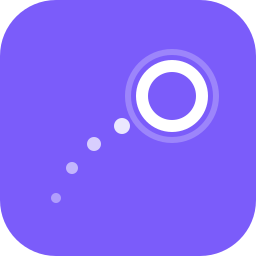
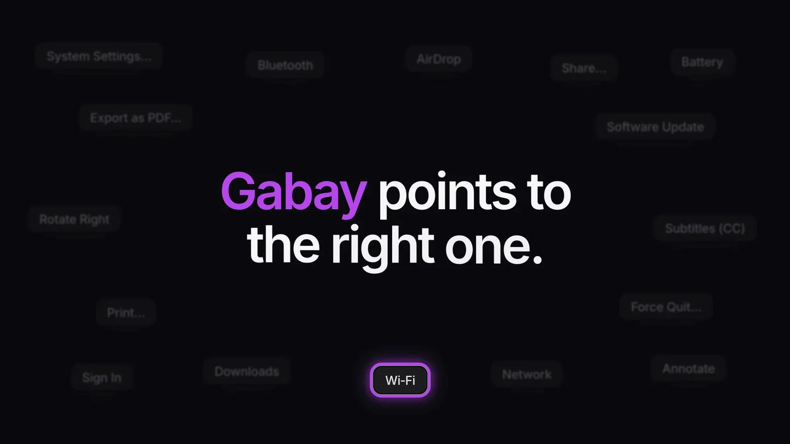
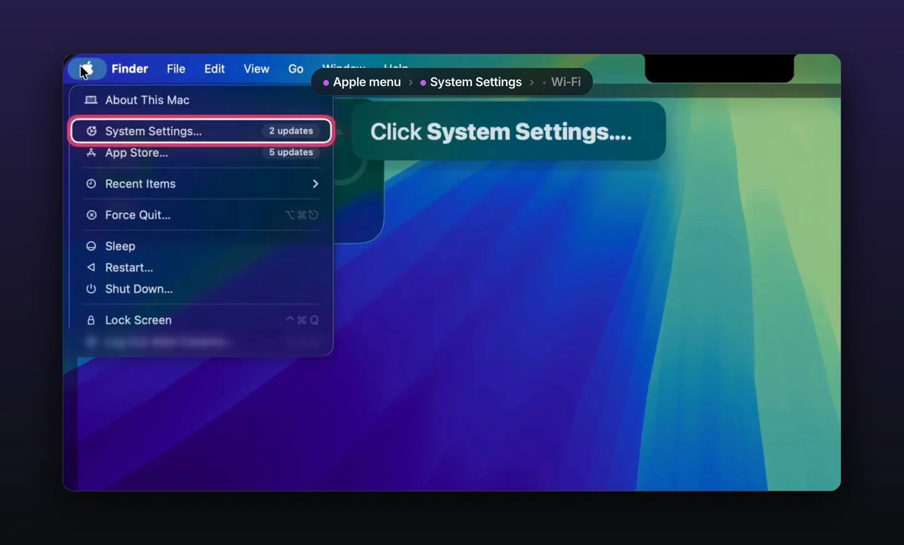
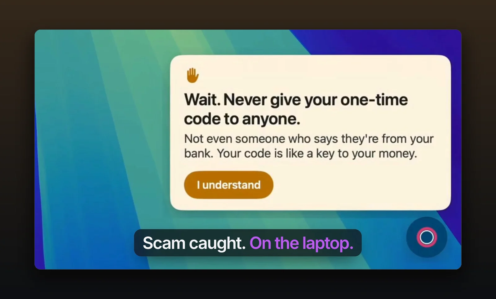

<div align="center">

<br>



# Gabay

**Shows you where to click on your Mac, one step at a time.**

Ask in English or Taglish. Gabay rings the next button and tells you what to do.<br>
You click, not Gabay. And the AI never leaves your Mac.

<a href="#what-it-does">What it does</a> ·
<a href="#benchmarks">Benchmarks</a> ·
<a href="#run-it">Run it</a> ·
<a href="docs/TECHNICAL.md">Technical details</a> ·
<a href="launch-videos/brag-output-2026-10-10-051615/gabay-launch-landscape.mp4">Demo video</a>

<br>


<br>



</div>

<br>

<table>
<tr>
<td width="50%"></td>
<td width="50%"></td>
</tr>
<tr>
<td align="center"><sub>One ring, one sentence.</sub></td>
<td align="center"><sub>"PhilHealth needs my OTP" gets a calm Wait.</sub></td>
</tr>
</table>

<br>

## What it does

*Gabay* is Filipino for "guide". It's for older and non-technical people, so they don't have to wait for family or share their screen with a stranger.

- **Points, never clicks.** A ring around the next button and one plain sentence. You click.
- **Reads the real buttons.** macOS Accessibility, not screenshots. Websites too, through a small extension.
- **Speaks Taglish.** "nawalan ako ng Wi-Fi" works, typed or spoken.
- **Runs on your Mac.** A 421M model we fine-tuned picks every step. It sends nothing off your Mac and works offline.
- **Catches scams.** Pauses "share your screen" or "read me your OTP" before you do it.

Built in two days at the **AppBuildersPH Hackathon 2026** (theme: Local AI). Finished **3rd** out of 1,200+ participants.

<br>

## Benchmarks

We fine-tuned [Laya](https://huggingface.co/convaiinnovations/laya), a 421M model small enough to run on a laptop, and tested it on apps it never saw in training.

| Model | Runs on | Held-out app goals | Scam check |
|---|---|---|---|
| Laya, base | Mac | 8 / 35 | 6 / 14 caught |
| **Gabay (fine-tuned v6en)** | **Mac** | **29 / 35** | **13 / 14 caught, 0 false alarms** |
| OpenAI `gpt-6-luna` | Cloud | 33 / 35 | |
| TypeSafe Jev | Cloud | 35 / 35 | 14 / 14 caught |

On real requests on our dev Mac, Gabay's first step was right **47 of 51** times. On websites it never trained on, it gets about **7 in 10** single steps right, so it asks "Is this what you wanted?" instead of assuming. Every number, with the command to reproduce it, is in [ml/RESULTS.md](ml/RESULTS.md).

<br>

## Run it

Needs an Apple Silicon Mac on macOS 26 with Apple Intelligence on, Xcode command-line tools, and Python 3.12.

```bash
pip install "laya[serve]"
curl -L -o /tmp/laya-guide-v6en.zip https://github.com/itsalexi/gabay/releases/download/laya-guide-v6en/laya-guide-v6en.zip
unzip /tmp/laya-guide-v6en.zip -d models

app/scripts/build_app.sh   # build Gabay
./run.sh                   # start the local model and the app
```

Then press **Option + Space**. Voice, the browser extension and training are in [docs/TECHNICAL.md](docs/TECHNICAL.md#full-setup).

<br>

## Team

Built by **qtr.zip** ([@itsalexi](https://github.com/itsalexi), [@EZA2405](https://github.com/EZA2405)) at the AppBuildersPH Hackathon 2026.

<br>

<div align="center">
<sub>MIT · built in two days at AppBuildersPH 2026</sub>
</div>
